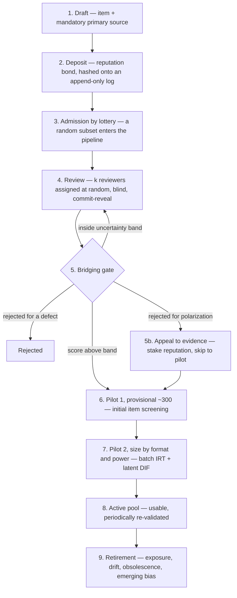

# Isegoria

**A distributed network for producing and validating quiz questions, where no
single authority decides what counts as a fair question.**

*Isegoria* (ἰσηγορία) was the ancient Athenian principle of the equal right of
every citizen to speak in the assembly.

> **Status:** a research reference implementation. The Rust engine has deterministic
> golden-output checks; Python comparisons are scoped numerical oracles, not bitwise
> equality with every current component. Phase 1 is still open: see the
> [review and correction register](docs/15-phase1-review.md), the
> [roadmap](docs/10-roadmap.md), and the [parameter register](docs/14-parameter-register.md).
> Implemented mechanisms and passing tests do not establish every claimed guarantee.
> See [Project status](#project-status) for deployment dependencies.
>
> **Phase 1 direction (2026-10-21, [`docs/01` D47](docs/01-decisions.md)):** reviewers now answer
> the question, whose key the author states. For the first implementation
> ([D48](docs/01-decisions.md)), reviewers drawn at random count equally, the consensus of their
> answers is the review's operational criterion — not a guarantee of truth — and evaluating their
> reliability is deferred. That mechanism is not yet fully specified or implemented; the code
> still has reviewers forecast whether a question passes its trial. The previous design's
> dossiers and studies are in
> [`archive/phase1-forecast-pilot/`](archive/phase1-forecast-pilot/README.md).

---

## Table of contents

- [In plain words](#in-plain-words)
- [A step deeper](#a-step-deeper)
- [What it deliberately does *not* solve](#what-it-deliberately-does-not-solve)
- [Code architecture](#code-architecture)
- [Try it](#try-it)
- [Documentation](#documentation)
- [Project status](#project-status)
- [License](#license)

---

## In plain words

*(No technical background needed for this section.)*

### The problem

Imagine we want a big, trustworthy set of quiz questions — say, questions about
how your country's institutions actually work. Who gets to decide which questions
are **fair** and **good**?

- If the **government** decides, it can quietly pick questions that make it look
  good.
- If we just let people **vote** on which questions are good, then whichever side
  has the most votes controls the questions — the problem just moves from the
  government to the biggest crowd.

So the hard part isn't collecting questions. It's deciding which ones are fair
**without trusting any single boss, and without it becoming a popularity contest.**

### The idea

Isegoria decides a question is good using **two checks in a row**, not a vote.

> *Changing (2026-10-21, [`docs/01` D48](docs/01-decisions.md)):* in the first version of the new
> design, the review step is settled by the consensus of randomly drawn reviewers' answers, each
> counting the same. The owner chose this knowingly, against "not a vote", and recorded its risks:
> shared mistakes, unequal expertise counted equally, careless reviews, coordination. A consensus
> is not proof that an answer is true. How many reviewers, how much agreement and what happens
> next are not decided yet, and the code still runs the two checks below.

**Check 1 — "Do people across the divide agree it's good?"**
A question doesn't pass just because *a lot* of people like it. It passes only if
people **from different sides** like it.

> Think of a film that both the action-movie critics *and* the art-house critics
> praise. That agreement across very different tastes is a strong sign the film is
> genuinely good — not just pandering to one crowd. A film only one camp loves
> gets filtered out.

*Where the code stands:* Check 1 averages the two sides' predicted approval, each side counting
once; what is left of the larger camp's advantage is a small measured leak (`docs/01` D32, done;
[`docs/13`](docs/13-characterization.md) §7.4). Since D47 the reviewers answer the question
instead of rating it; whether and how Check 1 reads their answers is still to be decided, and the
code still reads the earlier rating.

**Check 2 — "Does the question actually work when we try it?"**
The questions that survive Check 1 are tried out on real people, and we **measure**
what happens — no opinions involved:

- Does the question actually tell apart people who do better on the subject's
  questions from people who do worse? (A question everyone gets right, or everyone
  gets wrong, measures nothing.)
- Does it secretly favour one group over another **even when the statistical model
  places them at the same level**? If a question is worded so that one side "gets it"
  instantly and the other has to decode it, it's measuring which side you're on, not
  the subject. That question is thrown out.

People answer and review in the open: they may look things up or use AI tools. The model's
"level" is a statistical parameter; what it means — knowledge, skill with outside help, or
something else — is still to be settled, a right answer alone does not show unaided
knowledge, and using scores to give weight or authority would need its own justification
([`docs/01` D45](docs/01-decisions.md)). What the assessment aims at first is in
[D46](docs/01-decisions.md).

> Think of testing a thermometer. You don't take a poll on whether it *looks*
> accurate — you check it against reality. Check 2 is the reality check.

The whole point: the final decision is about **what the question does**, measured
in data, not about **what the network thinks** — and that's far harder to rig.

### "Anonymous, but one person = one voice"

Everyone takes part **anonymously** — no names, no political affiliation, nothing.
But the system still guarantees that behind each anonymous participant there is
**exactly one real person**, so nobody can create an army of fake accounts to tilt
the results.

> Think of a masked ball. At the door, a guard checks your ID to make sure one
> real person gets one mask. But once you're inside, nobody — not even the guard —
> can tell which mask is you.

Crucially, the guard (the ID check, e.g. a national digital ID) and the party
organiser (who hands out the anonymous "mask") are **different parties who never
compare notes**. That separation is what keeps the state from linking a person to
what they do.

### No money, ever

There is **no token, no stake, no payment** to take part. Paying to participate
would just recreate rule-by-the-wealthy — the very thing we're trying to avoid.
The only "cost" of proposing questions is your **reputation** and a rate limit.

---

## A step deeper

*(Still conceptual, a bit more precise. The full specification lives in
[`docs/`](docs/).)*

### Two levels

| | **Level A — Opinion** | **Level B — Evidence** |
|---|---|---|
| Input | Peer reviews from nodes | Real answers from samples of people |
| Question asked | "Does this look like a good item?" | "Does this item behave well?" |
| Attackable? | Yes, with coalitions | Very hard: you'd have to corrupt the sample |
| Role | Upstream filter | Final verdict |

Level A ("bridging") is essentially an **anti-spam filter for partisan items**.
The real verdict is Level B, computed from response data with standard
psychometrics (Item Response Theory + Differential Item Functioning).

### The three actions

Each person can do three things, each under a **separate, unlinkable pseudonym**:

- **Propose** — write a new question.
- **Judge** — peer-review other people's questions (this is the "voting" of the
  original idea). Since D47 a reviewer answers the question, as a respondent would; in the
  first version every reviewer counts the same and is not scored on those answers (D48). The
  code still asks for a forecast.
- **Answer** — act as a test subject so new questions can be trialled against real
  data.

### The lifecycle of a question



- **Nobody chooses what to review** (prevents brigading).
- **Nobody sees the author** (prevents voting on the person).
- **Nobody sees others' judgments before committing their own** (prevents cascades).
- **Under D47** the author states the key at step 1 and reviewers answer the question at step 4,
  free to look things up, AI included; reviewers do not state or record the sources they used.
  **Under D48** a reviewer may answer that none of the options is correct, and a question is never
  corrected afterwards: its author submits a new one. Whether the author keeps attaching a
  mandatory source at step 1, and whether and how steps 5–7 read the answers, are still to be
  decided.
- The **appeal** branch is the key correction: a *true but politically divisive*
  fact produces the same voting pattern as one-sided propaganda, so bridging would
  wrongly kill it. The appeal lets the author send it straight to the data-based
  filter, at the cost of their reputation, refunded if the psychometrics vindicate
  the item.

### Reputation: two separate scores, never combined

- **Author score `C_a`** — how good your proposed questions turn out to be;
  it only controls your **rate limit** on new proposals.
- **Evaluator score** — how reliable your reviews are; it may **weight your review**.

They live on **different, unlinkable pseudonyms** and are never merged. Under D47 the
evaluator score was to measure, over time, how reliable a reviewer's answers are. For the first
version D48 defers that: every reviewer weighs the same, ordinary reviews do not change the score,
and a later evaluation of reviewers would need a credible reference and its own decision.
Agreeing with the author or with the majority is not, by itself, reliability, and rewarding
agreement with the majority stays excluded. The author score stays separate: rewards for accepted
questions and penalties for contested or rejected ones have been discussed, with no formula, size
or conditions decided, and the implemented author score is unchanged. *Where
the code stands:* it implements the previous design, in which reviewers forecast whether a
question passes its trial and are scored by the difference between the other reviewers' Brier
error and their own — exactly zero for a reviewer who reports the others' mean — with 5% of the
gate's rejections piloted for measurement only (`docs/01` D33–D35). That rule is strictly proper
only under stated conditions: a defined baseline whose joint law with the outcome the report
does not move (`docs/02` §C.2). No general incentive guarantee is claimed for the protocol as
implemented: A1's and A12's closures are conditional, on a design the runtime does not implement
and on an offline candidate it does not use; A2 stays open
([`docs/15`](docs/15-phase1-review.md)).

### Anti-collusion

A cartel that votes as a block is detected by the correlation of what its ratings leave
**unexplained by the bridging model** — its residuals — over long histories, so honest
reviewers who merely share a position are not mistaken for one (`docs/01` D39). A
detected cluster is never seated twice on a panel (D40). The engine also keeps the
sub-linear measure of a bloc's influence: 500 coordinated nodes count for about
√500 ≈ 22 independent ones.

### Anonymous identity

Uniqueness is established by an external ID (national eID / CIE / SPID) that is
**cryptographically severed** from everything you then do. Each role's pseudonym is
derived deterministically, so it is **not rotatable** — you cannot burn a bad
reputation and start fresh (no "whitewashing").

### Tamper-proof storage without a blockchain

Questions and votes live on **signed, append-only logs** replicated across a
diverse consortium, made durable with **erasure coding** and periodically
**anchored** to a public chain. There is no heavy global consensus: the security
comes from operator **diversity** and from the fact that the scoring computation is
**reproducible** — anyone can re-run it and catch a dishonest signer.

---

## What it deliberately does *not* solve

Honest, structural limits (not bugs):

1. **True-but-divisive false negatives.** Bridging cannot tell a true polarizing
   fact from partisan propaganda; no threshold fixes this. Mitigation: the appeal
   channel.
2. **Pool-level bias.** Every item can pass the fairness test while the *choice of
   topics* is still skewed. Mitigation: fixed per-domain coverage quotas, set by
   lottery.
3. **The elite blind spot.** An item can be neutral on the political axis yet
   biased on a socio-economic one. Mitigation: multi-axis DIF, which must be looked
   for actively.
4. **"Competence" is still a construct someone chooses.** The psychometrics verify
   an item measures *one thing* coherently, not that it's the *right* thing — and, with
   answers given in the open ([`docs/01` D45](docs/01-decisions.md)), what that one thing
   means relative to unaided knowledge is still to be settled.
5. **The consortium's initial selection has no purely technical fix.** It's a human
   trust decision, made survivable (not fatal) by reproducible computation and the
   freedom to fork.

See [`docs/06-threat-model.md`](docs/06-threat-model.md) for the full threat
model.

---

## Code architecture

A Rust Cargo workspace. The scoring engine is isolated in a crate with **no
dependency on identity or network** — it runs offline and is reproducible
*in a way the compiler enforces*.

| Crate | Role | Status |
|---|---|---|
| [`scoring`](crates/scoring) | Deterministic engine: bridging (A), IRT/DIF (B), reputation (C), anti-collusion | **Implemented** for the previous design. Golden-output tests pin its outputs bit for bit across platforms and build profiles; scoped Python oracles check the numerical contracts their tests name, within tolerance. Open findings in [`docs/15`](docs/15-phase1-review.md), A2 among them; thresholds provisional; its evaluator score is the forecast score D47 sets aside |
| [`identity`](crates/identity) | Anonymous enrollment: source adapters, threshold-issued credential, role nullifiers | Scaffold + real mechanisms (single-server + threshold OPRF label, single + threshold BBS+ blind credential, ZK nullifier) |
| [`network`](crates/network) | Content addressing, Merkle, transparency log, consortium checkpoints, the epoch's beacon round, a node's durable log and objects, the replicated signed set and its cuts, erasure coding, anchoring | Real integrity primitives (incl. OpenTimestamps proofs), durable store (T13), replicated set and cuts (T18, T74); anchoring format-level only (T17) |
| [`protocol`](crates/protocol) | Lifecycle orchestration: deposit, lottery, blind review, gate + appeal, pilot, honeypot; a node's state from its log and from signed cuts | Wires the three layers together; the state replays from the log (T73) and from consortium-signed cuts (T74); no epoch run between nodes yet (T79) |
| [`p2p`](crates/p2p) | The libp2p transport: gossip announcements and pull sync of the replicated signed set; a consortium member's duties | Real (T18); a replica on disk, members cutting and running the beacon (T74); serves its whole set to any peer (T77); started only from tests (T78) |
| [`characterization`](crates/characterization) | The characterization harness: seeded simulation studies of the detectors and gates — a tool, not part of a node | T24's full run done: 54,412 runs, results in [`docs/13`](docs/13-characterization.md) §7; T25's supplement done: 19,700 runs, results in §8.7; also hosts the A2 probe binary, whose studies are archived |

The uniqueness label runs on a real single-server **VOPRF** (RFC 9497, via `voprf`)
*and* on a real **threshold** t-of-n OPRF (Shamir shares + per-share DLEQ over
Ristretto255), so no sub-threshold coalition can compute it; the anonymous credential
runs on real **BBS+** blind issuance (via `bbs_plus`), single-issuer *and* **threshold**
t-of-n (a DKG + base-OT + MPC signing protocol, so no `t-1` members can issue); each
per-role pseudonym carries a real Semaphore-style **ZK nullifier** proving it derives
from a valid credential (a sigma-protocol bound to the BBS+ credential — no
circom/Groth16 stack); and anchoring runs on the real **OpenTimestamps** proof format
(via `opentimestamps`). What remains is a real distributed key-generation ceremony and
transport for the two committees, the live network side of anchoring (a calendar server
and a Bitcoin block source), plus peer-to-peer transport (libp2p) and convergent state
(CRDT).
The rule throughout is *prefer mature,
audited libraries* behind clean traits; bespoke cryptography is a considered exception
— allowed when it serves the design, kept small, built on vetted primitives, and
tested — not the default.

For how the design maps onto the code, module by module, see
[`ARCHITECTURE.md`](ARCHITECTURE.md).

---

## Try it

```sh
cargo test --workspace                 # acceptance + property (proptest) + reproducibility + end-to-end
cargo clippy --workspace --all-targets
cargo llvm-cov --workspace --summary-only   # line coverage (~97%); needs cargo-llvm-cov
cargo run --release -p characterization -- run --grid smoke   # every study, one tiny cell each
```

The full characterization (T24) is 54,412 seeded runs, about 30 hours on an 8-core
desktop; it is resumable and runs on demand, never in CI
([`docs/13`](docs/13-characterization.md) §2). Its results are in `docs/13` §7, its
tables in [`verification/reports/t24/`](verification/reports/t24/). T25's supplement —
the model with the guessing floor, and the band's extra round — is `--study t25`, 19,700
runs, about 10 hours on the same machine; its results are in `docs/13` §8.7, its tables in
[`verification/reports/t25/`](verification/reports/t25/).

CI runs the comment budget (`scripts/comment_budget.py`, see `docs/CLAUDE.md`), fmt,
clippy (`-D warnings`), the full test suite, and coverage on every push and pull request
(`.github/workflows/ci.yml`).

Part of the scoring tests run against **fixtures exported from the Python simulations** in
[`sim/`](sim/), each within the contract its test names; the simulations keep retired models
and are not a complete specification of the current engine. To regenerate the fixtures you
need `numpy`/`scipy` (see `sim/`).

---

## Documentation

- **This README** — the layered overview above.
- **[`ARCHITECTURE.md`](ARCHITECTURE.md)** — design-to-code map, invariants, plug
  points, test strategy (English).
- **[`docs/`](docs/)** — the full conceptual specification:
  - [`00-overview.md`](docs/00-overview.md) — overview
  - [`01-decisions.md`](docs/01-decisions.md) — architectural decisions (ADR)
  - [`02-scoring-engine.md`](docs/02-scoring-engine.md) — the mathematical core
  - [`03-identity-enrollment.md`](docs/03-identity-enrollment.md) — identity
  - [`04-storage-network.md`](docs/04-storage-network.md) — storage & network
  - [`05-question-lifecycle.md`](docs/05-question-lifecycle.md) — lifecycle protocol
  - [`06-threat-model.md`](docs/06-threat-model.md) — threat model
  - [`07-verification-and-assurance.md`](docs/07-verification-and-assurance.md) — verification methodology
  - [`08-formal-specification.md`](docs/08-formal-specification.md) — independent audit: what is implemented, tested, still open
  - [`10-roadmap.md`](docs/10-roadmap.md) — **the development plan, by priority**
  - [`11-mutation-testing.md`](docs/11-mutation-testing.md), [`12-panic-audit.md`](docs/12-panic-audit.md) — test-quality reports
  - [`13-characterization.md`](docs/13-characterization.md) — T24 and T25's supplement: the characterization studies, their harness, and their results
  - [`14-parameter-register.md`](docs/14-parameter-register.md) — the thresholds' register: why each exists, how it is calibrated, what breaks if it moves
  - [`15-phase1-review.md`](docs/15-phase1-review.md) — open review findings and correction handoff
  - [`21-d47-inventory.md`](docs/21-d47-inventory.md) — what D47 affects: kept, to adapt, archived, still needed
  - [`99-glossary.md`](docs/99-glossary.md) — glossary, from scratch
- **[`sim/`](sim/)** — historical research prototypes and scoped test oracles.
- **[`archive/phase1-forecast-pilot/`](archive/phase1-forecast-pilot/README.md)** — the previous
  Phase 1 design's dossiers, A12's and A2's tools and A2's results, with a path map (D47).
- **[`paper/`](paper/)** — working paper on the mathematics of the mechanism: formal statement,
  proofs, reproducible experiments and open problems ([PDF](paper/main.pdf)); a dated snapshot,
  whose evaluator score is the previous design's.

---

## Project status

| Layer | State |
|---|---|
| Scoring engine (A + B + C + anti-collusion) | Implemented, with Rust golden-output checks across platforms/build profiles and scoped Python comparisons; open guarantees and code-contract findings in [`docs/15`](docs/15-phase1-review.md), A2 open; thresholds provisional |
| Design revisions from the working paper ([`paper/`](paper/)): side-balanced bridge score, evaluator difference score with exploration, DIF anchor precondition and target model, contested-facts selection, residual-based coordination detection (`docs/01` D32–D41) | D32–D41 implemented (T49–T57, T37); implementation completion does not close the guarantee findings in `docs/15` |
| Findings of the third review (2026-09-24): deposit replay, respondents not identity-gated, consortium threshold, appeal stake, band items without appeal (`docs/08` §0-quinquies) | Deposit replay (T64), respondent gate (T65), band items without appeal (T59), the band's re-decision on the same panel (T60), the appeal stake (T61) and the consortium threshold (T63) fixed; the rest — no-show reviewers, a hand-built empty panel, the honeypot's fixed draw — confirmed by tests on master and planned in Phase 3 (`docs/10` T58, T66, T67) |
| Identity, network, protocol | Working scaffolds; deterministic mechanisms + single-server & threshold OPRF label + single & threshold BBS+ credential + ZK nullifier + OpenTimestamps anchoring proofs real, remaining heavy crypto/transport behind traits |
| Transport and external backends | libp2p replication and consortium-signed cuts implemented (T18/T74); committee DKG/transport and live anchoring remain roadmap work |
| Meta-level governance (stratified sortition) | Future work |
| Reviewers answer the question (`docs/01` D47, 2026-10-21); first implementation (D48): reviewers drawn from the pool, equal weights, the consensus of the answers as the operational criterion, the evaluation of reviewers deferred | Decided as a direction; the group's size, quorum and absences, thresholds and outcomes, a possible "don't know", the author's reputation, the source at deposit, the previous filters' role and A2 still to decide; not implemented |

**What comes next**, in order (task status lives in the [roadmap](docs/10-roadmap.md)):

1. **Mathematics** — take the decisions D48 leaves open, specify the mechanism of D47 and D48,
   then implement it, adapting what
   [`docs/21`](docs/21-d47-inventory.md) lists; keep the findings in
   [`docs/15`](docs/15-phase1-review.md) within their scopes (A2 stays open); complete T25's
   measurements and parameter procedures where D47 leaves them in place. T81 is complete for its ten named files.
   T24 and the guessing supplement are historical campaigns; their DIF/DTF/floor
   records predate D43 and must not be presented as validation of that model.
2. **P2P network** — finish the runtime, recovery, discovery, availability and
   confidentiality work listed in `docs/10` §2.3. Persistence and replication already
   exist; they are not an unstarted transport project.
3. **The rest** — protocol-boundary completion, distributed identity, external
   reviews, statistical privacy and empirical pilots.

This is a research/specification-stage project. Nothing here is production-ready
security; the cryptographic plug points are explicitly non-production. A `p2p` node
serves everything it replicates — the drafts under review and every reviewer's rating
joined to its pseudonym included — to any peer that connects ([`docs/10`](docs/10-roadmap.md)
T77): run it only among machines you control.

**Scale.** Sample-size constants are provisional admission floors, not demonstrated
power requirements. Guessing-aware results depend strongly on format and batch design;
the historical tables predate D43. A viable capacity estimate must count anchor answers,
rejected/inconclusive batches and distinct respondents. See
[`docs/02-scoring-engine.md`](docs/02-scoring-engine.md) §B.6.

---

## License

[EUPL-1.2](LICENSE).
